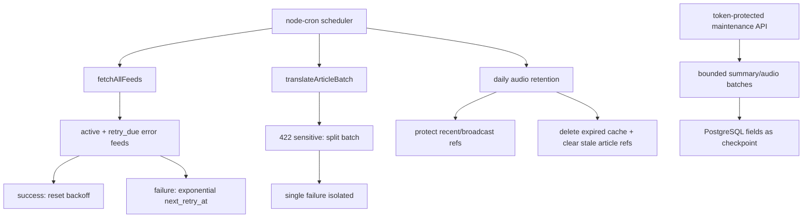

# 架构开发文档：生产稳定性修复与近一周内容再生成

## 1. 背景和目标

生产巡检发现根分区 100%、音频缓存无保留策略、52/57 RSS 源永久退出 scheduler、MiniMax 单条敏感拒绝拖垮翻译批次，以及 PostgreSQL `DATE` 被 UTC 序列化导致 Digest 日期偏移。本方案先止血，再通过最小热修恢复可持续运行，最后分批再生成近一周摘要和音频。

## 2. 当前系统理解

| 维度 | 项目事实 | 证据 | 影响 |
| --- | --- | --- | --- |
| 部署 | Supervisor `polanews` 运行 Next standalone，cwd 位于 `.next/standalone` | 生产进程与配置巡检 | 相对音频路径落入 `.next` 构建树 |
| 数据 | PostgreSQL `worldoverview` | `app/src/lib/db/schema.ts` | 清理需事务、备份和引用核对 |
| RSS | 失败 5 次后置 `error`，默认 scheduler 只查 active | `app/src/lib/rss/engine.ts` | 失败源永久退出 |
| AI | 翻译每批 10 条，provider error 直接抛出 | `app/src/lib/ai/llm.ts` | 单条 422 中断全部翻译 |
| TTS | 文件落盘，无 retention；scheduler 每轮预生成 30 条 | `app/src/lib/services/tts.ts` | 文件无界增长 |
| Digest | 列表 route 对 JS Date 使用 `toISOString()` | `app/src/app/api/digests/route.ts` | Asia/Shanghai 日期减一天 |

## 3. 项目 Arch Reference 摘要

- 路径：`docs/pola/arch-reference.md`
- 复用：现有 `runFullIngest`、`translateArticleBatch`、`summarizeArticle`、`synthesizeAudio`、PostgreSQL helper、Supervisor standalone 部署。
- 约束：不改变页面/API 主契约；运行时文件必须使用显式持久目录；后台任务必须有锁、超时、退避和上限。

## 4. 架构选型分析

| 候选方案 | 一致性 | 复用 | 验证 | 部署风险 | 回滚 | 结论 |
| --- | --- | --- | --- | --- | --- | --- |
| A 仅清盘并重复现有 pipeline | 高 | 高 | 低 | 低 | 易 | 只能短暂止血，永久失活和批次失败仍存在 |
| B 扩展现有 scheduler/service，增加受控维护入口 | 高 | 高 | 高 | 中 | 可逐文件/配置回滚 | 推荐 |
| C 新建独立 worker + 对象存储 | 中 | 低 | 中 | 高 | 复杂 | 当前磁盘故障不适合扩大架构 |

### 架构选型结论

选择 B：在现有服务内增加 RSS 退避、翻译二分隔离、音频 retention 和 token 保护的批量维护入口。拒绝 A 是因为无法持续恢复；拒绝 C 是因为需要新基础设施和迁移，不能作为本次热修。

决策约束：生产基线固定 `6a92017`；不带入 main 的其它功能；不绕过 provider 内容安全；清理前必须 dry-run + DB/配置备份；维护批量必须可续跑。

## 5. 数据流

## 6. 数据与接口设计

- `feeds.last_attempted_at TIMESTAMPTZ`、`feeds.next_retry_at TIMESTAMPTZ`：支持退避；启动迁移使用 `ADD COLUMN IF NOT EXISTS`。
- 退避：`min(24h, 15m * 2^(error_count-1))`，成功清零并恢复 active；paused 永不自动尝试。
- 音频保留：默认 30 天；只删除受控目录内超过 cutoff、非 Broadcast 保护的 UUID `.mp3`。dry-run 返回候选指纹，apply 必须匹配并重验 inode/mtime/size；先清空目标 URL/hash，再精确 unlink，避免数据库失败留下断链。
- 维护 API：`POST /api/ops/maintenance`，Header `X-PolaNews-Ops-Token`，action 为 `status` / `summaries` / `audio`，每批有硬上限；不返回 secret。
- 再生成 checkpoint：先备份和重置近一周目标字段；后续只处理缺失字段。连续无进展停止，重复调用幂等。
- Digest 日期：对 PostgreSQL `DATE` 使用本地年月日字段，ISO 字符串只截取原始日期部分，禁止把 date-only 值转 UTC。

## 7. 并发、超时、日志和成本护栏

- RSS 并发保持 15，单源 10 秒；error 源仅在 `next_retry_at` 到期时进入。
- 摘要并发保持 3；维护 API summary 单批不超过 20。
- 音频保持串行；维护 API audio 单批不超过 10。
- scheduler 既有进程锁保留；音频清理增加独立运行锁，每日一次。
- 日志只输出数量、阶段和脱敏错误类型，不输出 token、原文、Authorization 或完整 provider body。
- 再生成限制在明确时间窗，使用 DB 缺失字段和外部 checkpoint 控制重试。

## 8. 文件改动计划

| 文件 | 动作 | 对应验收 |
| --- | --- | --- |
| `app/src/lib/db/schema.ts` | 增加 feed retry 字段 | A4 |
| `app/src/lib/rss/engine.ts` | retry-due 查询、退避更新、时间窗批处理能力 | A4/A7/A9 |
| `app/src/lib/ai/llm.ts` | 敏感失败二分隔离与脱敏日志 | A5/A10 |
| `app/src/lib/services/tts.ts` | retention、受控删除、引用修复、时间窗处理 | A1-A3/A7/A9 |
| `app/src/lib/rss/scheduler.ts` | 每日 retention 调度与锁 | A3/A9 |
| `app/src/app/api/ops/maintenance/route.ts` | token 保护的有界维护入口 | A7/A9/A10 |
| `app/src/app/api/digests/route.ts` | date-only 正确归一化 | A6 |
| `app/scripts/` | dry-run/再生成调用与 checkpoint 辅助脚本 | A1/A7/A9 |
| `app/package.json` | 运维脚本入口 | A1/A7 |

## 9. 测试策略

- 纯逻辑：退避计算、MiniMax 批次隔离、日期归一化、音频候选判定。
- 静态：ESLint、TypeScript/Next build、deploy doctor。
- 集成：测试库或只读/dry-run 验证 schema/清理统计；生产真实 maintenance 小批次。
- 回归：首页、文章、Feeds、Digest、Broadcast、TTS、匿名 401、静态资源。
- 生产观察：磁盘、PostgreSQL、Supervisor、scheduler 一轮、日志泄密和 5xx。

## 10. 部署和回滚

部署顺序：生产备份 → 磁盘 dry-run/受控止血 → 先配置绝对音频路径 → 上传 hotfix 文件 → build/doctor → 配置 ops token → Supervisor reload → smoke → 再生成 → 恢复 scheduler → 观察。

回滚：恢复生产代码/构建与 Supervisor 配置；feed 新列为兼容性附加列可保留；恢复近一周数据备份；音频文件删除无法原地恢复，但对应文章缓存字段清空后可重新生成，manifest 保留完整清单。

## 11. 验收映射

需求 A1-A12 全部映射到 `docs/pola/project-knowledge/delivery/2026-10-06-production-stability-weekly-regeneration/function_test_cases.json`。
